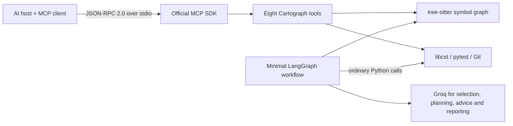

# Cartograph architecture

Cartograph has three separate pieces. MCP is its integration boundary;
LangGraph is a small example workflow; tree-sitter builds the code data they use.



## MCP: what is actually implemented

`mcp_server/server.py` constructs the official SDK's `MCPServer`.
Decorated functions become tools with generated input/output schemas.
The SDK implements JSON-RPC framing, protocol negotiation, tool discovery,
validation, dispatch and protocol errors. Cartograph implements the functions.

The lockfile uses MCP SDK **2.0.0**; the dependency requirement is
`mcp>=2.0.0,<3`, matching the imported API.
The server uses local **stdio**. It is not a deployed HTTP service.
Modern discovery and the legacy initialize handshake are both exercised with
a separate SDK client process. A raw subprocess test also checks JSON-RPC
version fields, correlated IDs, tool calls and a `-32601` unknown-method error.

Eight tools are exposed:

| Tool | Purpose |
| --- | --- |
| index_repo | Return graph counts and unresolved-call coverage |
| find_definition | Find symbols by exact name |
| find_callers | Find known direct callers |
| blast_radius | Find known transitive callers |
| run_tests | Execute pytest and return structured outcomes |
| snapshot | Capture tracked and non-ignored files in a Git object |
| rollback | Restore files and the index from a snapshot |
| apply_codemod | Apply a registered deterministic libcst recipe |

The previous ninth registration, `pack_context`, raised `NotImplementedError`.
It is no longer advertised. Its Python prototype is still explicitly deferred.

Each server is bound to one repository at startup. Query calls refresh the
graph from source, avoiding stale state and any client-supplied graph. They
do not write an index cache. This favors simple correctness over maximum
throughput; large repositories may need an in-memory incremental cache later.
Symbol lists have stable ordering, a page limit of 100 and `next_offset`.
Pagination is not an atomic snapshot across concurrent external edits.
Callers should re-query if files change.

Tests and write tools require `--allow-execution`. Tests execute repository
code; this is a trusted local tool, not a sandbox. Rollback removes newer
non-ignored files and updates the real Git index; it does not move HEAD.
Query containment excludes Python symlinks resolving outside the repository.
These boundaries do not isolate malicious code or concurrent filesystem changes.

## LangGraph: four sequential stages, five roles

```text
START -> inspect -> plan -> execute -> report -> END
```

- **inspect:** index the repository, then Scout selects relevant symbols.
- **plan:** Planner chooses ordered recipe-based steps.
- **execute:** a regular Python loop invokes Rewriter once per step.
  Rewriter snapshots, applies a codemod, tests changes, and restores failures.
  Adjudicator offers advice if a recipe reports ambiguity; candidate
  recommendations are not automatically executed. Ambiguous work is quarantined.
  A final real pytest run determines the report's test status.
- **report:** Reporter summarizes the recorded outcomes.

There are five roles: Scout, Planner, Rewriter, Adjudicator and Reporter.
They are not five autonomous workers and not five graph nodes.
Only state, nodes, edges, `compile()` and `invoke()` are needed to understand
the LangGraph integration. There are no graph cycles, checkpoint stores,
resume threads, subgraphs or parallel scheduling.

The pipeline calls the same underlying Python functions as the MCP adapter.
It is **not an MCP client**, and it does not send JSON-RPC between its nodes.
`examples/mcp_client.py` demonstrates the actual MCP client path separately.

A failed test restores files before requesting an optional LLM diagnosis,
so a provider outage cannot prevent rollback. Exceptions during a codemod
or test execution also trigger restoration. This is a local best-effort
transaction; filesystem/Git failures can still make rollback fail.

## Claims and limits

- Static call edges are estimates, not complete runtime dependency analysis.
  Dynamic calls and unknown receivers can remain unresolved.
- The bundled codemod handles supported unittest assertions. It is not a
  general autonomous refactoring engine.
- `scripts/benchmark_context.py` measures payload bytes on named queries.
  It does not establish tokenizer-level savings, model quality or speed.
- No live Groq result is claimed by offline tests. The live-provider test
  runs only when a key is configured.
- Legacy context-budget and run-budget settings remain advisory/deferred;
  there is no enforced model token budget. The per-step routing budget was
  removed with the retry graph.

See [MCP learning guide](mcp-guide.md) for setup and protocol examples.
